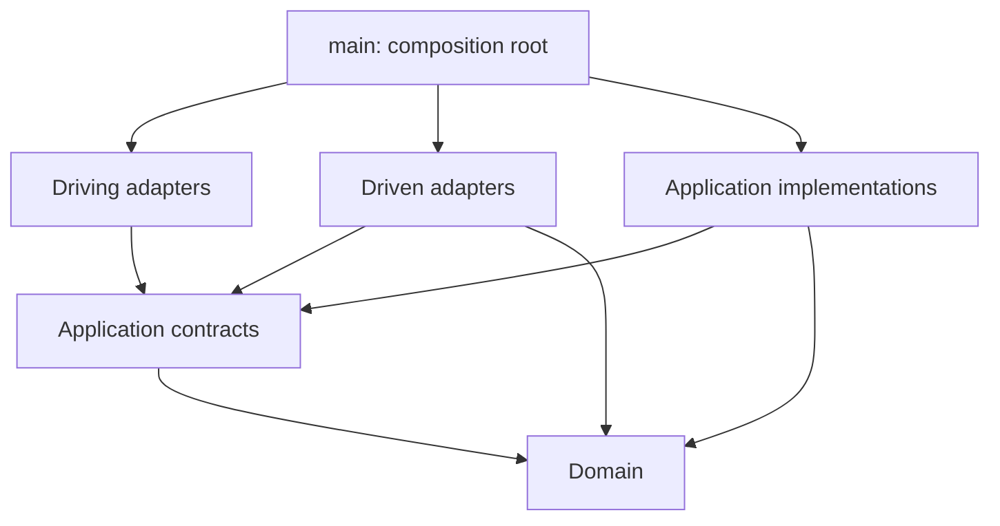

# System Topology: Ports and Adapters (Hexagonal) with DDD

## Architectural Zones: Inside, Outside, and Bootstrapper

### Inside: Domain and Application

Each bounded context contains `domain` (business behavior with DDD) and `application` (orchestration and ports) on the inside

The inside has no third-party runtime dependencies: language features and standard-library pure data utilities are allowed (except for date/datetime). Database, network, filesystem, environment belong outside and reach application code through ports.

### Outside: Infrastructure and Main
 `infrastructure` (frameworks, libraries and I/O adapters) is on the outside. `main` is the composition root, not a business layer. It constructs and connects the objects and manages process lifecycle.

## Architectural Dependencies: Source Imports Versus Runtime Calls

Use **driving** for application interfaces invoked by driving adapters, and **driven** for application interfaces that application workflows invoke and driven adapters implement. Keep these terms consistent across contracts, adapters, and setup.

The arrows below represent source dependencies. A use case can call a driven port at runtime while a driven infrastructure adapter implements that port; this does not introduce an application import of infrastructure. Dependencies between business layers point inward. Construction dependencies originate in `main`.

## Architectural Import Matrix: Source-Level Permissions

`YES` grants permission, not a requirement. The matrix applies within a bounded context; topology specifications further restrict cross-context imports. Application contracts may reference domain types in driven ports, while driving contracts expose only plain DTOs and primitives.

| Source | Import domain | Import application contracts | Import application implementations | Import infrastructure | Import main |
| :--- | :---: | :---: | :---: | :---: | :---: |
| domain | YES | NO | NO | NO | NO |
| application | YES | YES | YES | NO | NO |
| infrastructure | YES | YES | NO | YES (helpers/resources only; no peer adapters) | NO |
| main | YES | YES | YES | YES | YES |

Adapters are independent: they MUST NOT import, inject, construct, or call each other, even through interfaces. Application workflows coordinate operations across ports. Infrastructure self-import permission covers adapter-local helpers, pure mappers, and shared technical resources, not peer adapters.

## Deployment Topology Selection: Service and Context Boundaries

| Deployment need | Read |
| :--- | :--- |
| One simple backend serving browser, desktop, mobile, or other network clients | [Single service](./topologies/single-service.md) |
| Multiple bounded contexts within one deployable | [Modular monolith](./topologies/modular-monolith.md) |
| Independently deployed bounded contexts with network integration | [Microservices](./topologies/microservices.md) |

The single-service topology provides the baseline client-server layout, request flow, public API boundary, and optional storage guidance. All topologies use the [composition-root rules](./core-rules/04-main-composition-root.md): idiomatic DI split into logical setup files, with one main entrypoint selecting and activating enabled modules per deployable. Technical DI modules do not imply multiple business contexts.

## Architectural Topology Invariants (DO NOT VIOLATE)

1. Domain and application code MUST NOT import infrastructure, frameworks, or main.
2. Infrastructure MUST depend on application contracts rather than concrete use cases, queries, or policies.
3. Main MUST contain construction and lifecycle logic only; no business decisions or workflow orchestration.
4. Runtime invocation direction MUST NOT be mistaken for source dependency direction.
5. A deployment topology MUST preserve bounded-context ownership and these inward dependency rules.
6. Infrastructure adapters MUST NOT depend on one another; application workflows coordinate their operations through ports.
