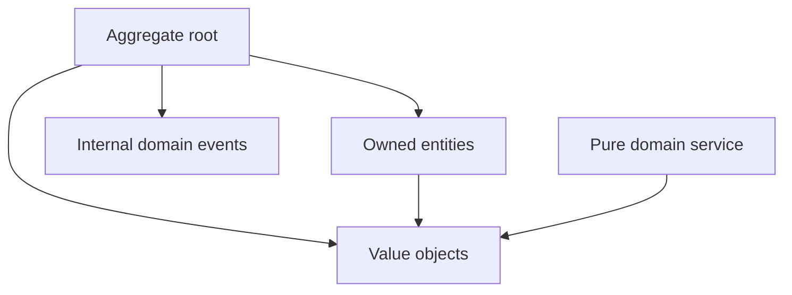
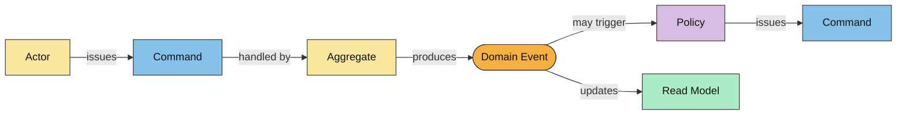

# Layer Specification: Domain Inside the Core

The domain layer is the hearth of the system, here live the business rules and invariants that define the problem space. It is the only layer that contains business logic; all other layers are orchestration, translation, or infrastructure. The domain layer is a pure model of the business, with no dependencies on frameworks, I/O, or other layers.

The domain layer makes use of pure Domain Driven Design as much as possible.


## Domain Layer: Directory Responsibilities

Adhere to the following example directory structure as much as possible

```text
Domain/
├── Orders/                         # One folder per aggregate, named in plural
│   ├── Events/                     # Events owned by this aggregate
│   ├── ValueObjects/               # Values owned by this aggregate
│   ├── Order                       # Aggregate root
│   ├── OrderRepository             # One repository interface per aggregate
│   ├── OrderAsserts                # Aggregate invariant assertions
│   ├── OrderLine                   # Aggregate-owned entity
│   └── ...
├── Shared/                           # location for common base classes or interfaces
└── CrossAggregates                  # All concepts that span multiple aggregates
    ├── ValueObjects/                # If no single aggregate owns the value, put it here
    └── Domain1Service1.cs           # Location of a pure domain service that spans multiple aggregates
```

Each aggregate has its own plural-named folder. Keep its root, owned entities, assertions, and aggregate-specific types in that folder; put its events and value objects in the corresponding child folders. Domain services that do not belong to one aggregate live directly under `Domain/CrossAggregates`. Use the language's normal file-naming convention. A repository interface lives beside its aggregate; infrastructure provides its implementation.

## Domain Layer: Tactical DDD Rules

- **Aggregates:** Expose named command methods on aggregate roots. Keep child entity collections and mutation inaccessible to callers; root methods control invariant checks and event recording. Reference other aggregates by typed IDs, not live object references. Prefer one aggregate per consistency boundary; workflows spanning boundaries require an explicit application transaction or eventual consistency design.
- **Entities:** Use private/protected construction where the language supports it, or equivalent encapsulation. `create(...)` validates a new entity. Child creation and mutation occur through the root.
- **Value objects:** Model domain concepts such as email addresses, IDs, and money as immutable values with value equality and construction validation. Primitives remain appropriate inside value objects, for incidental values, and at DTO boundaries.
- **Domain events:** Immutable, past-tense business facts such as `OrderPlacedEvent`. Roots collect events in memory. Domain objects never publish to brokers or invoke policies; the application controls transaction and dispatch timing. These event types are private to the bounded context.
- **Domain services:** Pure business calculations that do not fit an entity or value object. They can use supplied domain objects and values, but cannot load aggregates or coordinate external calls.
- **Repositories:** Provide a persistence-agnostic interface for aggregate retrieval and storage. They are implemented in the infrastructure layer. A repository is a port interface that exceptionally is located in the domain because it's fundamental to the aggregate lifecyle.

## Domain Layer: Source Dependency Matrix

| Dependency | Allowed |
| :--- | :---: |
| Same-context domain types and pure standard-library utilities | YES |
| Application ports or DTOs | NO |
| ORM, transport, DI framework, or external I/O | NO |
| Main or another context's domain types | NO |

## Domain Layer: Source Dependency Graph



## Command-to-Event Flow

In Alberto Brandolini's EventStorming notation, domain events are past-tense facts arranged in time; commands express intent, and policies can react to events by issuing further commands.



## Command-to-Event technical translation

In a ports-and-adapters architecture, the command-to-event flow is implemented as follows:

- Actor: no technical translation, this is a human or external system that initiates a command.
- Command: an application layer UseCase
- Aggregate: a domain layer aggregate root
- Domain Event: a domain layer event type
- Policy: an application layer orchestration class (Policy) that reacts to a domain event
- Read Model: an application layer data class that is updated by some system (this could be infrastructure or application layer projection)

## Domain Layer Invariants (DO NOT VIOLATE)

1. Domain code MUST NOT perform I/O, read environment variables, sample clocks/randomness, or initiate asynchronous external work.
2. Domain code MUST NOT contain ORM, HTTP, serialization-framework, or dependency-injection annotations.
3. All externally initiated aggregate mutations MUST pass through the aggregate root.
4. Domain events and entities MUST NOT become cross-context contracts.
5. Public state changing methods on an aggregate MUST end with the raise of a domain event or a domain exception. Query methods MUST NOT raise events. If the specification does not specify a domain event, create a domain event for future use and raise it.
6. Only public state changing methods on an aggregate root are allowed to raise domain events.
