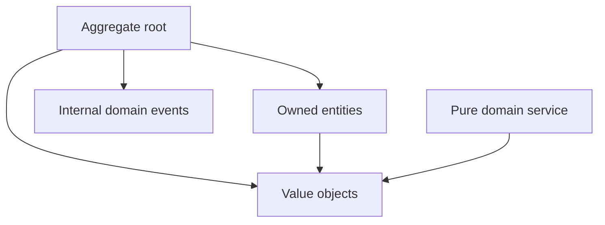

# Layer Specification: Domain Inside the Core

## Domain Layer: Directory Responsibilities

```text
Domain/
├── Orders/                         # One folder per aggregate, named in plural
│   ├── Events/                     # Events owned by this aggregate
│   ├── ValueObjects/               # Values owned by this aggregate
│   ├── Order                       # Aggregate root
│   ├── OrderRepository             # Optional domain-owned repository port
│   ├── OrderAsserts                # Aggregate invariant assertions
│   ├── OrderLine                   # Aggregate-owned entity
│   └── ...
└── DomainServices                  # Pure operations without a natural entity owner
```

Each aggregate has its own plural-named folder. Keep its root, owned entities, assertions, and aggregate-specific types in that folder; put its events and value objects in the corresponding child folders. Domain services that do not belong to one aggregate live directly under `Domain/`. Use the language's normal file-naming convention. A repository interface may live beside its aggregate when it is fundamental to that aggregate; infrastructure provides its implementation.

## Domain Layer: Tactical DDD Rules

- **Aggregates:** Expose named command methods on aggregate roots. Keep child entity collections and mutation inaccessible to callers; root methods control invariant checks and event recording. Reference other aggregates by typed IDs, not live object references. Prefer one aggregate per consistency boundary; workflows spanning boundaries require an explicit application transaction or eventual consistency design.
- **Entities:** Use private/protected construction where the language supports it, or equivalent encapsulation. `create(...)` validates a new entity; `reconstitute(...)` restores valid persisted state without creation events. Child creation and mutation occur through the root. Reject corrupt persisted state without replaying business actions.
- **Value objects:** Model domain concepts such as email addresses, IDs, and money as immutable values with value equality and construction validation. Primitives remain appropriate inside value objects, for incidental values, and at DTO boundaries.
- **Domain events:** Immutable, past-tense business facts such as `OrderPlacedEvent`. Roots collect events in memory. Domain objects never publish to brokers or invoke policies; the application controls transaction and dispatch timing. These event types are private to the bounded context.
- **Domain services:** Pure business calculations that do not fit an entity or value object. They can use supplied domain objects and values, but cannot load aggregates or coordinate external calls.
- **Repositories:** Provide a persistence-agnostic interface for aggregate reconstitution and storage. They are implemented in the infrastructure layer. A repository is a port interface that exceptionally is located in the domain because it's fundamental to the aggregate lifecyle.

## Domain Layer: Source Dependency Matrix

| Dependency | Allowed |
| :--- | :---: |
| Same-context domain types and pure standard-library utilities | YES |
| Application ports or DTOs | NO |
| ORM, transport, DI framework, or external I/O | NO |
| Main or another context's domain types | NO |

## Domain Layer: Source Dependency Graph



## Domain Layer Invariants (DO NOT VIOLATE)

1. Domain code MUST NOT perform I/O, read environment variables, sample clocks/randomness, or initiate asynchronous external work.
2. Domain code MUST NOT contain ORM, HTTP, serialization-framework, or dependency-injection annotations.
3. All externally initiated aggregate mutations MUST pass through the aggregate root.
4. Reconstitution MUST NOT record or dispatch new business events.
5. Domain events and entities MUST NOT become cross-context contracts.
