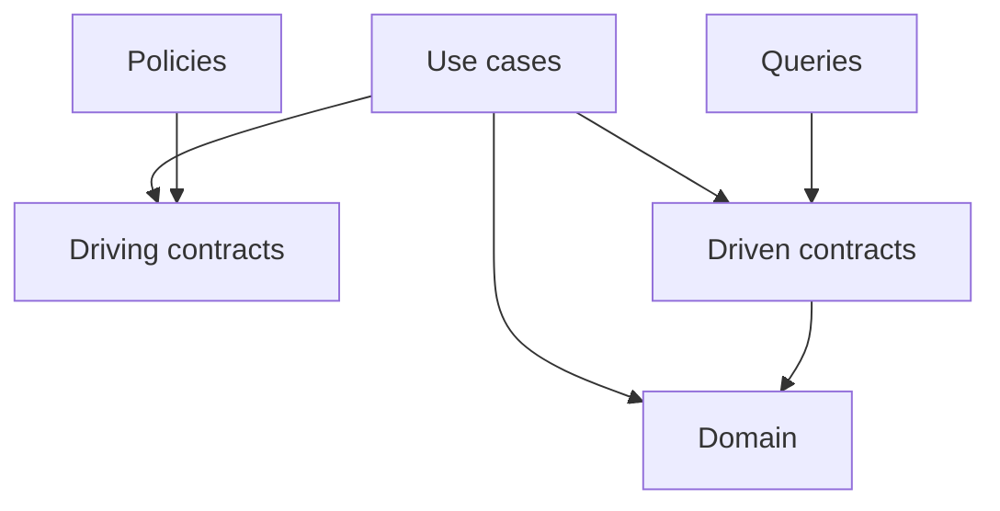

# Layer Specification: Application Orchestration

## Application Layer: Directory Responsibilities

```text
Application/
├── CreateOrder         # One verb-named use case per file
├── CancelOrder
├── Queries/            # Read-only DTO-producing operations
├── Policies/           # Event-triggered follow-up workflows
└── Contracts/
    ├── Driving/        # Application interfaces and command/query/event DTOs
    └── Driven/         # Read model, transaction, gateway ports and other driven interfaces
```

Directory names start with a capital letter. Place each use case directly under `Application/` in its own file, named with the action verb (for example, `CreateOrder`). Do not add a `Use-Cases/` subfolder. Use the language's normal file-naming convention.

## Application Layer: Driving and Driven Port Rules

Driving interfaces are implemented by use cases, queries, and policies. Their argument is a plain DTO and results are plain DTOs or primitives, never aggregate instances or vendor types. Driven interfaces are implemented by driven adapters and supplied through constructor injection. Repository ports may reference same-context aggregates; read-model ports return DTO projections.

Use cases load aggregates, invoke domain behavior, persist changes, and return DTOs. Queries may bypass aggregates through dedicated read-model ports, while preserving authorization, context ownership, and read-only behavior. Policies handle internal domain events or mapped integration-event DTOs and invoke follow-up driving ports; their dependencies should be interfaces, not concrete use cases.

## Application Layer: Transactions and Reliable Event Delivery

The application owns transaction boundaries through a driven unit-of-work port. Its callback receives transaction-scoped repository and outbox ports, or an equivalent explicit transaction context; unrelated repository sessions are not sufficient. The driven implementation uses the same database transaction for aggregate changes and integration-event outbox inserts. The application selects and maps internal events to producer-owned public event DTOs, never publishes domain objects.

```text
begin unit of work
  load aggregate -> invoke domain method -> save aggregate
  map recorded domain events -> append integration DTOs to outbox
commit
dispatch local post-commit policies; relay committed outbox independently
```

On rollback, no external publication or post-commit dispatch occurs. Retried work must reload state and discard events from failed instances. Handle internal events before commit only when all handler effects participate in the same explicit transaction and perform no external effects. Post-commit in-memory policies are best effort; use durable dispatch when losing a follow-up is unacceptable.

For external calls that cannot join the database transaction, use explicit idempotency and compensation/process coordination. A database rollback cannot undo a payment API call. Cross-context workflows do not assume one global transaction.

Coordinate operations involving several adapters in application workflows, never inside an adapter. For example, an outbox relay workflow exposes a driving interface for a driving scheduler and uses separate driven outbox-store and publisher ports. It reads committed records, publishes, and marks delivery after acknowledgement without coupling the persistence and broker adapters. Transaction-scoped repository and outbox ports share a DI-supplied database transaction resource, not dependencies on each other's adapters.

## Application Layer: Source Dependency Matrix

| Dependency | Allowed |
| :--- | :---: |
| Same-context domain | YES |
| Application contracts and implementations | YES |
| Infrastructure or main | NO |
| Another context's internal code or vendor SDK types | NO |

## Application Layer: Source Dependency Graph



## Application Layer Invariants (DO NOT VIOLATE)

1. Application code MUST NOT import infrastructure, main, or framework/vendor types.
2. Driving contracts MUST NOT expose domain objects; driven repository ports MAY use internal domain types.
3. External dependencies MUST be injected through driven interfaces; policy follow-ups use driving interfaces.
4. State and required integration-event outbox records MUST commit or roll back together.
5. No event indicating committed state may be externally published before commit.
6. Read models MUST respect bounded-context storage ownership and access control.
