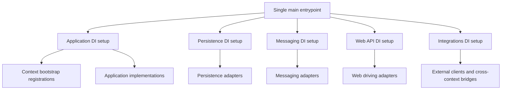

# Bootstrap Specification: Main Composition Root

## Composition Root: Language-Agnostic Directory Responsibilities

The names below describe logical files without language-specific extensions. Use the target language's file naming and package conventions.

```text
Main/
├── Program                       # Single entrypoint selects and activates setup modules
├── Modules/
│   ├── Application/              # Register use cases, queries, policies, and context bootstraps
│   ├── BackgroundProcesses/      # Register scheduled and hosted workers
│   ├── IAM/                      # Register identity and access integrations
│   ├── Messaging/
│   │   ├── DomainEvents/         # Register local domain-event dispatch
│   │   └── IntegrationEvents/    # Register publishers, consumers, and outbox relay
│   ├── Persistence/
│   │   ├── Read/
│   │   │   └── Dapper/           # Read-side DI and lifecycle setup
│   │   └── Write/
│   │       └── EntityFramework/  # Write-side DI and lifecycle setup
│   └── WebApi/                   # Register transport handlers and server lifecycle
└── Properties/                   # Host/project properties, when applicable
```

The `Main/` area is a bootstrapper, not a business layer. It's ports & adapters name is `composition root`. `Modules/` groups logical registration and lifecycle setup by technical responsibility; these folders configure adapters but do not contain their implementations, which remain in `Infrastructure/`. The entrypoint and setup files collectively form one composition root. It may import every same-context zone to assemble the dependency graph. Infrastructure can import both domain and application contracts for mapping; only composition-root code may import concrete application implementations together with concrete adapters for construction. Add or split setup files by cohesive responsibility as the application grows; do not consolidate all registrations into one container file or the main entrypoint.

## Composition Root: Idiomatic Dependency Injection

Use dependency injection throughout composition. Prefer the language/platform's built-in DI facility or the established default of the project's framework, including its module registration, scope, disposal, and hosting conventions. Languages have different defaults: when no standard facility exists, use the project's established DI mechanism; without one, use explicit constructor injection and modular factories. Do not impose a particular container or add a custom DI framework to satisfy this specification.

Keep domain and application code independent of container APIs and DI annotations. Register interface-to-implementation bindings in the relevant setup file and let the DI mechanism construct the object graph where supported. Select lifetimes deliberately: transaction/request-scoped dependencies must not be captured by longer-lived singletons. Container resolution belongs in composition and framework-managed activation boundaries, never in business methods as a service locator.

Each logical setup file owns its related registrations, configuration validation, and resource lifecycle setup. For example, persistence binds repository and transaction ports; messaging binds event publishing ports and registers consumers; webapi binds transport handlers to driving interfaces. Register application implementations in the application setup file. Use one host/container per deployable where supported; setup modules extend that shared builder rather than constructing independent containers.

Keep adapters independent when registering services: inject driving application interfaces into driving adapters and bind driven interfaces for application workflows. Do not inject adapters into other adapters, including via interfaces. Shared database pools, transaction contexts, and vendor clients are technical resources that DI may supply to multiple adapters. A dependency between setup modules does not authorize a dependency between their adapters.

## Composition Root: Module Selection and Activation

One main entrypoint loads configuration, selects enabled setup modules, validates their dependencies, invokes their registration hooks on the shared builder, and then builds and starts the host. Its module list or configuration is the single place to enable or disable modules; adding a module should require its setup file and a selection entry, not changes across unrelated registration files. Setup modules MUST NOT activate each other implicitly.

Each setup module exposes an idiomatic registration hook with configuration and the DI builder (or equivalent modular factory inputs), declares dependencies on other setup modules, and registers lifecycle hooks when needed. These are responsibilities, not a prescribed language-specific interface. Reject missing enabled dependencies or dependency cycles before starting resources, with a diagnostic naming the affected modules. Do not silently enable a disabled dependency or substitute an unrequested implementation. For example, enabling messaging that uses a database-backed outbox requires persistence; webapi and messaging may be independently disabled when no other enabled module requires them.

Disabled modules register no bindings or lifecycle hooks, require no module-specific configuration, and start no connections, listeners, or workers. Enabled modules validate their own configuration before startup. Register the full graph before resolving services; defer I/O and resource startup to lifecycle hooks. Validate required bindings and scope compatibility before serving work, using the DI facility's validation support where available.

```text
main entrypoint:
  load configuration and select enabled setup modules
  validate selected modules and their declared dependencies
  register selected modules with one shared DI builder
  build and validate the host and required bindings
  start registered resources, then accept work
  on termination, drain work and dispose registered resources
```

## Composition Root: Wiring and Lifecycle

The selected setup modules arrange injection of driven adapters through driven interfaces into use cases/queries/policies, and of driving interfaces into driving adapters. Start workers and listeners after required resources are ready. Prefer the platform's host and DI lifecycle facilities for ordering and disposal. On startup failure, close already-created resources; on shutdown, stop accepting work, drain in-flight operations, then stop relays and close resources in dependency-safe order with bounded timeouts.

In a modulith, each bounded context has a construction-only bootstrap entrypoint, separate from its public contract facade. Bounded contexts and technical DI setup modules are different concepts: the global composition root's selected setup files invoke context bootstraps and register cross-context bridges. Bootstraps contribute private registrations to the shared DI mechanism and expose only public driving interfaces and lifecycle ownership. With modular factories, return those interfaces and lifecycle handles explicitly. Bootstrap may construct its context's private implementations but cannot run business workflows or build a separate container. Treat it as composition-root code, even though it sits beside the context facade. Avoid constructor dependency cycles; use explicit deferred interface bridges where necessary and never invoke business behavior during registration.

## Composition Root: Source Dependency Matrix

| Source or Dependency | Allowed |
| :--- | :---: |
| Main imports domain, application implementations, and infrastructure | YES |
| Global composition-root setup files import context bootstrap entrypoints | YES |
| Module bootstrap imports its own internal implementations | YES |
| Domain, application, or infrastructure imports main/bootstrap | NO |
| Module bootstrap imports another module's bootstrap | NO |
| Business code resolves dependencies from a DI container | NO |
| Setup module implicitly enables another setup module | NO |

## Composition Root: Construction Dependency Graph



## Composition Root Invariants (DO NOT VIOLATE)

1. Domain, application, and infrastructure MUST NOT import main or module bootstrap entrypoints.
2. Composition-root setup and bootstrap code MUST contain no business decisions or workflow orchestration.
3. Use idiomatic DI with constructor injection and framework-managed activation where available; business code MUST NOT depend on the container.
4. DI registrations and lifecycle setup MUST be grouped into logical setup files, never centralized in one container or entrypoint file.
5. One main entrypoint MUST select and activate setup modules through an explicit module list or configuration.
6. Disabled modules MUST register and start nothing; missing dependencies and setup dependency cycles MUST fail before resource startup.
7. Only the global composition root may consume context bootstrap entrypoints; bounded contexts MUST NOT bootstrap each other.
8. All required bindings and lifetime compatibility MUST be validated before listeners accept work; setup files MUST NOT build separate containers.
9. Startup failure and shutdown MUST release owned resources without abandoning unbounded work.
