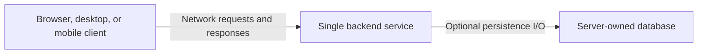

# Deployment Topology: Single Service for Client-Server Applications

## Single Service: Deployment Shape and Intended Use

Use this topology for a simple backend serving a browser, desktop, mobile, or other network client. The backend is one bounded context and one deployable application, with one composition root and server-owned storage when needed. Multiple endpoints or use cases do not require separate bounded contexts or services.

The client communicates through the server's public network API. It can live in the same repository or a separate repository and have its own release lifecycle. Serving static client assets from the backend is optional and belongs in infrastructure. The server's internal layering does not prescribe the client's architecture.



This diagram shows runtime communication, not source imports. A database is optional for stateless services. The baseline request-response setup needs no message broker, event bus, inter-module facade, or integration-event envelope. Introduce these only when an actual integration or delivery requirement calls for them.

## Single Service: Language-Agnostic Server Layout

Names without extensions describe file roles.

```text
Server/
├── src/
│   ├── Domain/
│   ├── Application/
│   ├── Infrastructure/
│   └── Main/
└── tests/
    ├── UnitTests/          # tests for domain, application, and infrastructure layers
    ├── DesignTests/        # general design tests for DDD and ports & adapters
    └── ArchitectureTests/  # general architecture tests for DDD and ports & adapters
```
